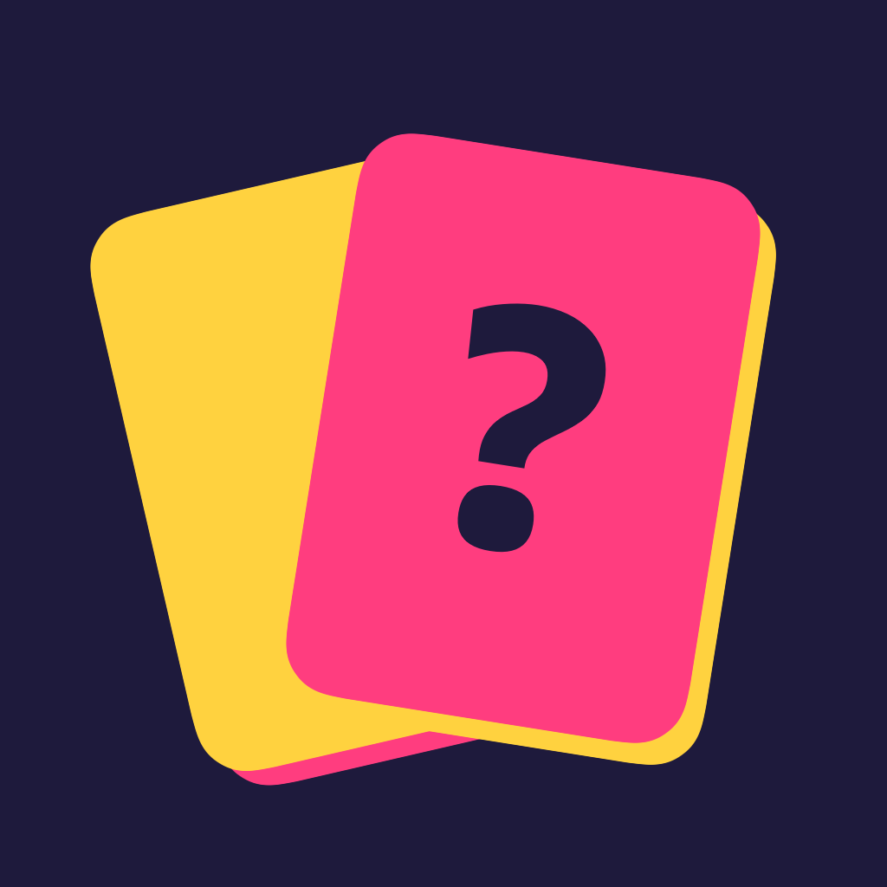

<p align="center">
  
</p>

<h1 align="center">Imposter</h1>

<p align="center">
  Our own ad-free take on the "Imposter Who?" party game, for iPhone.<br>
  Everyone gets the secret word except the imposter, who has to bluff their way through the clues.
</p>

<p align="center">
  
  
  
  
  <a href="LICENSE"></a>
</p>

No ads, no accounts, no internet. One phone gets passed around the table. It's a personal
project, installed with a free Apple ID rather than through the App Store.

## How a round works

1. **Pass the phone.** Each player holds to see their card in private. The crew all see the
   same secret word. The imposter doesn't.
2. **Give one-word clues.** Go around the circle. Prove you know the word without giving it away.
3. **Talk it over.** Who hesitated? Whose clue was a bit too vague?
4. **Vote.** Pass the phone for secret ballots, or do a quick group vote. A tie means nobody
   is accused.
5. **Last chance.** A caught imposter can still steal the win by guessing the word.

## Features

- **3 to 15 players**, with a saved, seat-ordered roster.
- **626 words in 12 categories**: food, animals, movies, jobs, places, sports, around the
  house, music, famous people, drinks, video games and countries. Each word has hints and
  decoys, and words don't repeat until you've been through the deck.
- **Custom word packs** you write yourself, or paste in as a list.
- **House rules**, saved between games:
  - **Imposter intel:** nothing, one related hint word, or a decoy word (undercover mode, where
    the imposter doesn't know they're the imposter).
  - **Multiple imposters**, always fewer than the crew.
  - **Troll rounds:** a chance that everyone is secretly the imposter.
  - Clue rounds per game, turn and discussion timers, and whether an imposter may go first.
  - Categories and difficulty (easy, medium, hard).
- **Game-night scoreboard** that tracks points across rounds.
- **Made for a dark room:** every card looks the same from across the table, so a glance never
  gives a role away. Haptics, synthesized sound effects (with an off switch) and support for
  the largest Dynamic Type sizes.

## Install it on your iPhone

You need a Mac with [Xcode](https://apps.apple.com/app/xcode/id497799835) and a free Apple ID.
The full walkthrough is in [docs/INSTALL.md](docs/INSTALL.md). In short:

```sh
brew install xcodegen           # once
scripts/setup-signing.sh        # once: picks up your free Personal Team
scripts/install-on-iphone.sh    # every 7 days, when the app stops opening
```

Apps signed with a free Apple ID expire after 7 days. Re-installing takes about a minute and
keeps your players, house rules and word packs.

## Run it in the simulator

Open `Imposter.xcodeproj`, pick a simulator and press **Run** (⌘R). Or, from the terminal:

```sh
scripts/build.sh simulator
```

## Project layout

| Path | What's there |
|---|---|
| `ImposterKit/` | Swift package with the game engine and word content. No UI, fully unit tested. |
| `App/` | The SwiftUI iPhone app, split by feature (`Home`, `Players`, `Setup`, `Game`, `Packs`). |
| `project.yml` | XcodeGen spec that generates `Imposter.xcodeproj`. Run `xcodegen generate` after adding files. |
| `Config/` | Shared build settings. Your personal signing lives in an untracked `Signing.local.xcconfig`. |
| `scripts/` | Build, test, install and asset scripts (see below). |
| `docs/` | [Roadmap](docs/ROADMAP.md), [design](docs/DESIGN.md), [word content](docs/CONTENT.md), [install guide](docs/INSTALL.md). |

## Scripts

| Script | What it does |
|---|---|
| `scripts/test.sh` | Runs the ImposterKit tests, including the word-content quality checks. |
| `scripts/build.sh` | Regenerates the project from `project.yml` and builds the app. |
| `scripts/setup-signing.sh` | Writes your free Apple ID team into `Config/Signing.local.xcconfig`. |
| `scripts/install-on-iphone.sh` | Builds and installs the app on a connected iPhone. |
| `scripts/screenshots.sh <udid>` | Screenshots every screen on a simulator using debug scenes. |
| `scripts/render-icon.swift` | Redraws the app icon. |
| `scripts/render-sounds.swift` | Re-synthesizes the sound effects. |

## Contributing

- Game rules belong in `ImposterKit` with [Swift Testing](https://developer.apple.com/documentation/testing)
  coverage. Run `scripts/test.sh` before committing.
- Commits follow [Conventional Commits](https://www.conventionalcommits.org/) with the scopes
  `kit`, `content`, `app`, `host` and `web`.
- Want more words? [docs/CONTENT.md](docs/CONTENT.md) explains the category format and what
  makes a good word.
- Note notable changes under **Unreleased** in [CHANGELOG.md](CHANGELOG.md).

## What's next

Host mode: the iPhone runs the game and friends join from any phone's browser (iPhone or
Android) by scanning a QR code over local Wi-Fi. See the [roadmap](docs/ROADMAP.md).

## License and credits

The code is released under the [MIT License](LICENSE). The bundled font,
[Bricolage Grotesque](https://github.com/ateliertriay/bricolage) by the Bricolage Grotesque
Project Authors, keeps its own [SIL Open Font License](App/Resources/Fonts/OFL.txt).
